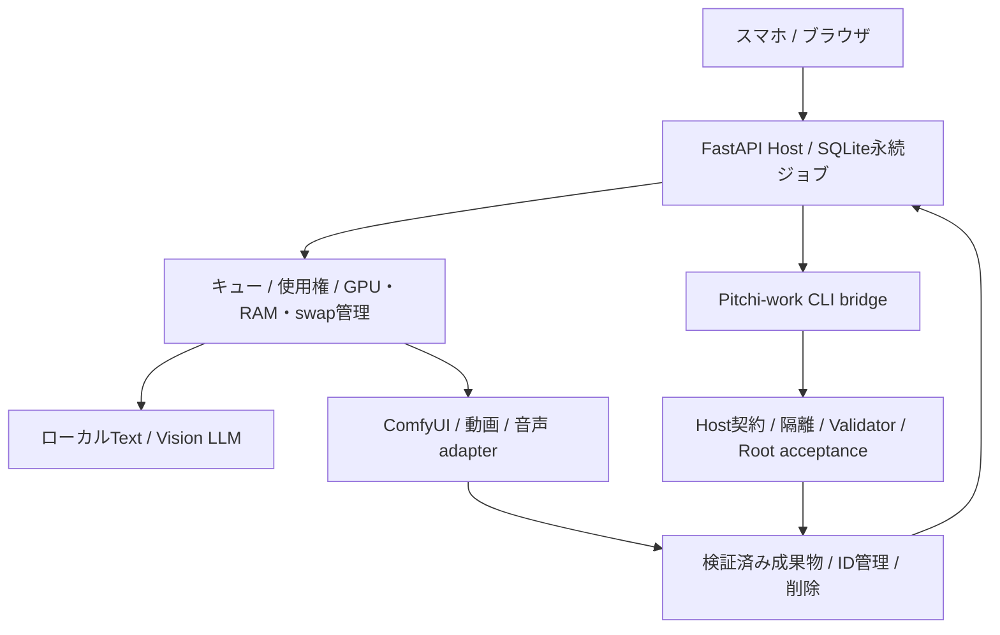
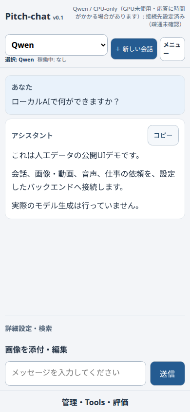

# Pitchi-chat

スマートフォンからローカルAIを使うための、Web UIとFastAPI Hostです。
会話、画像編集、動画、音声、仕事の依頼を、利用者が設定したバックエンドへ接続します。

> 自作コードはMIT Licenseで提供します。実験段階の機能と必要な外部依存は以下を確認してください。
> モデル・ComfyUI・音声サービス・実データは同梱しません。

## 対応するAI機能

| 機能 | 状態・条件 |
|---|---|
| 通常Chat、履歴、SSE、再接続、モデル選択 | 実装済み。対応するローカルAPIとHost-owned profileの設定が必要 |
| Strata / Qwen系ローカルLLM | adapter実装済み。モデル名・互換API・起動条件を利用者が設定 |
| 画像添付、参照画像編集、画像理解 | 実装済み。編集はComfyUI、画像理解は対応Visionモデルが必要。Text専用モデルには画像理解させない |
| ComfyUI画像生成 | Qwen-Image、FLUX.2 Klein等のadapter実装済み。モデルとworkflowは別導入 |
| 短尺動画、T2V/I2V、MP4 | LTX / MiniMax H3経路を実装。LTXの実機I2V成功実績あり。別環境での動作保証ではない |
| 長尺動画 | 親子クリップ、停止/再開、最終フレームI2V、結合、最大180秒の構成を実装。180秒の実生成・長い連続I2V品質は未検証 |
| 音声合成 | IRODORI互換adapter実装済み。対応する別サービスを明示設定 |
| 履歴・成果物管理 | 会話、画像、動画、音声のIDベース削除・共有参照保護・失敗再試行を実装 |
| Pitchi-work連携 | CLI bridge、source pin、承認・検証の受渡しを実装。対応profileのみ実行可能 |
| 任意クラウド連携 | 承認・送信制御を実装。初期OFF。プロバイダごとの利用可否は別確認 |

ComfyUI等が所有する元ファイルは、正式な削除APIを確認できない場合には削除しません。
バックアップや端末保存もHostからの削除対象外です。削除画面の範囲を確認してください。

## システム構成



## 必要な環境

- Python 3.11以上。最小UI/Hostの起動にGPUは不要です。
- GPU連携はLinux/NVIDIAを想定。開発時の実機はRTX 3060 12GB、RAM 64GBでした。
- 必要RAM/VRAMはモデルごとに違います。64GB構成や48GiB等の閾値を他環境へ一律適用しないでください。
- メディアには別途ComfyUI、モデル、FFmpeg/FFprobe。音声・Vision・検索等は使用機能に応じて追加。
- 開発テストはpytest、Node、Chromeを使用。一部の正式隔離検証にはbubblewrap/systemd等が必要です。

## 導入

```bash
git clone https://github.com/pitchipt-dotcom/pitchi-chat.git
cd pitchi-chat
uv sync --locked --group dev
bash scripts/start.sh
```

`http://127.0.0.1:8000`を開きます。モデル未設定でもUI/healthを確認できますが、生成はできません。
終了はCtrl+C。workerは1つで使用します。既存モデルや別サービスをinstall時に自動起動しません。

モデル連携時は、公開テンプレートをignoredなローカルファイルへコピーします。

```bash
cp config/settings.toml config/settings.local.toml
cp config/resources.toml config/resources.local.toml
export PITCH_CHAT_CONFIG="$PWD/config/settings.local.toml"
export PITCH_CHAT_RESOURCES_CONFIG="$PWD/config/resources.local.toml"
```

続きは[設定](docs/CONFIGURATION.md)、[安全性](SECURITY.md)、[モデルと権利](docs/MODEL_LICENSES.md)。
`.env.example`は変数の説明です。`.env`を置くだけで自動読込みはしません。
スマホからは許可した端末だけのHTTPS経路を別途設定してください。インターネットへの直接公開を前提としません。

## スクリーンショット



公開UIを隔離したデモAPI・人工データで表示した画面です。実会話や生成物、運用URLは含みません。

## 開発と検証

```bash
uv run --locked --group dev python -m pytest -q
```

mock/CPU回帰と実モデル実績は分けます。公開準備の回帰結果は[検証記録](docs/VALIDATION.md)を参照。
実生成用probeは明示的な操作です。インストールや通常テストでモデル取得・課金送信を行わないでください。

## 関連資料

[Pitchi-work](https://github.com/pitchipt-dotcom/pitchi-work) · [MIT License](LICENSE) ·
[Privacy](PRIVACY.md) · [Contributing](CONTRIBUTING.md) · [第三者依存](THIRD_PARTY_NOTICES.md)

## ライセンス

自作部分は[MIT License](LICENSE)。Copyright (c) 2026 pitchipt-dotcom。
第三者の依存ライブラリ・モデル・ソフトの条件は別です。[適用範囲](LICENSING.md)を確認してください。
